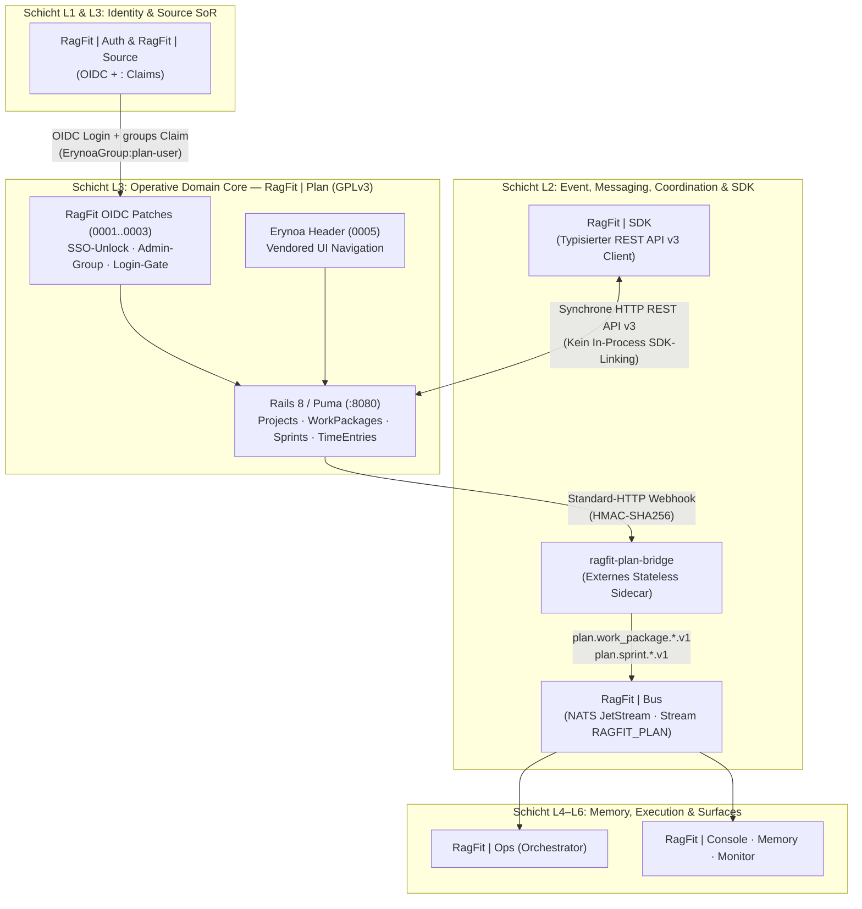

<p align="center">
  <picture>
    <source media="(prefers-color-scheme: dark)" srcset="ragfit/brand/ragfit-by-en-stacked-white-transparent.png">
    
  </picture>
</p>

# RagFit | Plan

| Feld | Wert |
|---|---|
| **Status** | Production Core (`ragfit-plan-v<semver>`) |
| **Tier** | Tier 1 — Foundational Domain Core |
| **Layer** | Schicht L3 (Operative Domain Cores — Systems of Record) in der RagFit v4.0 7-Schichten-Gesamtarchitektur (`L0`–`L6`) |
| **Plattform-Scope (`W8`)** | **Souveräne Agent-First-Plattform-Dienstfamilie `RagFit \| *`** (7-Schichten-Architektur `L0`–`L6`) |
| **Upstream / Lizenz** | OpenProject `v17.9.1` ([LICENSE](./LICENSE), `GPL-3.0-only`) · Änderungen dokumentiert in [CHANGES-RAGFIT.md](./CHANGES-RAGFIT.md) |
| **System of Record** | Projects, WorkPackages, Sprints, Boards, Roadmaps, Relations, TimeEntries |
| **Container Build** | `nix build .#container` / `just image` (leichtgewichtiges Rootless-OCI-Image) · Release-CI Multi-Arch via `docker/prod/Dockerfile` |

**RagFit | Plan** ist das zentrale Projekt- und Arbeitsplanungs-System-of-Record (Schicht `L3`) der Plattform-Dienstfamilie **`RagFit | *`** (`L0`–`L6`). Es verwaltet Projects, WorkPackages, Sprints, Agile Boards, Roadmaps und TimeEntries. Die Anmeldung erfolgt per OpenID Connect mit strikter `<org>:<team>`-Autorisierung; die Anbindung an `RagFit | Bus` (NATS JetStream Stream `RAGFIT_PLAN`) erfolgt unter Wahrung vollständiger **GPLv3-Lizenzisolation** über das externe, zustandslose Sidecar `ragfit-plan-bridge`.

> **Architektonische Einordnung (`W8`-Auflösung):**
> - **RagFit (`RagFit | *`)** bezeichnet exklusiv die souveräne, 7-schichtige (`L0`–`L6`) Engineering-, Wissens-, Observability- und Multi-Agenten-Plattform der ErynoaGroup (`L0` NixOS-Substrat, `L1` `RagFit | Auth`, `L2` `RagFit | Bus` & `RagFit | SDK`, `L3` `RagFit | Source` & `RagFit | Plan`, `L4` `RagFit | Memory` & `atlasd`, `L5` `RagFit | Ops`, `RagFit | Agent` & `RagFit | Runner`, `L6` `RagFit | Console`, `RagFit | Docs`, `RagFit | Monitor` & `rk`).

---

## Quickstart

```bash
# 1. Hermetische Entwicklungsumgebung starten (Ruby 3.4, Node.js 22, just, jq, git, PostgreSQL)
nix develop

# 2. Erynoa-Healthcheck & Sicherheits-Guards prüfen (Leak-Guard, Asset-Guard, Notice-Guard, Patch-Serie)
just doctor

# 3. Leichtgewichtigen Rootless-OCI-Container reproduzierbar über Nix bauen
just image
# oder direkt:
nix build .#container

# 4. Schnelle Vorab-CI (Leak-Guard, Trigger-Check, Workflow-Lint, Patch-Serie, Asset- & Notice-Guard)
just ci-quick
```

---

<!-- ERYNOA-MODEL:BEGIN -->
## Model

> **SE-04 C4-Systemkontext & Container-Sicht.** Tiefgehende 7-Schichten-Architektur (`L0`–`L6`) & GPLv3-Lizenzisolation: [`docs/ARCHITECTURE.md`](./docs/ARCHITECTURE.md) · Agenten-Doktrin: [`erynoa.md`](./erynoa.md).


<!-- ERYNOA-MODEL:END -->

---

## Systemgrenzen, Datenflüsse & GPLv3-Lizenzisolation

| Schnittstelle | Richtung | Protokoll / Format | Zweck |
|---|---|---|---|
| **OIDC Login & Team-Gate** | `RagFit \| Source` / `Auth` → `RagFit \| Plan` | OpenID Connect (`groups`-Claim `<org>:<team>`) | Fail-closed Login-Autorisierung (`RAGFIT_OIDC_<PROVIDER>_LOGIN_GROUPS`) und Admin-Synchronisation (`RAGFIT_OIDC_<PROVIDER>_ADMIN_GROUP`) |
| **Synchrone Service-API** | `RagFit \| SDK` / `Ops` → `RagFit \| Plan (:8080)` | OpenProject REST API v3 (`application/hal+json`) | Typisierte Lese-/Schreibzugriffe auf Projects, WorkPackages, Sprints und TimeEntries über Netzwerkgrenzen |
| **Webhook → Bridge → Bus** | `RagFit \| Plan` → `ragfit-plan-bridge` → `RagFit \| Bus` | HTTP Webhook (HMAC) → `RagFitEventEnvelopeV1` auf Stream `RAGFIT_PLAN` | Übersetzt WorkPackage- und Sprint-Änderungen außerhalb des GPLv3-Prozesses in signierte NATS-Events (`plan.work_package.created.v1`, `plan.work_package.updated.v1`, `plan.sprint.*.v1`) |

### RagFit Patch-Serie (`ragfit/patches/`)

Alle Anpassungen gegenüber Upstream OpenProject sind in fünf isolierten Patches gekapselt und in [CHANGES-RAGFIT.md](./CHANGES-RAGFIT.md) dokumentiert:
1. **`0001-sso-unlock.patch`:** Schaltet OpenID-Connect-Provider-Konfiguration und -Login gemäß GPLv3 §§ 7, 10 frei (SAML und andere Enterprise-Funktionen bleiben unverändert).
2. **`0002-oidc-admin-group.patch`:** Synchronisiert das Admin-Flag bei jedem Login exakt gegen einen vollständigen `<org>:<team>`-Claim in `RAGFIT_OIDC_<PROVIDER>_ADMIN_GROUP` (z. B. `ErynoaGroup:platform-admin`).
3. **`0003-oidc-login-gate.patch`:** Fail-closed Login-Gate auf `RAGFIT_OIDC_<PROVIDER>_LOGIN_GROUPS` (nur vollständige `<org>:<team>`-Claims), Passwort-Login-Sperre für OIDC-verknüpfte Konten sowie Rake-Task `ragfit:oidc:revoke_ungated[provider]`.
4. **`0004-e2e-user-cleanup.patch`:** Synchroner Bereinigungs-Task `ragfit:e2e:delete_users[e2e-]` für automatisierte E2E-Testläufe.
5. **`0005-erynoa-header.patch`:** Rendert die vendorte Erynoa-Navigationsleiste (`public/erynoa/1.1.1/`, geprüft gegen `SHA256SUMS`) oberhalb der Oberfläche.

---

## Build, Release & Supply Chain

- **Leichtgewichtiger Nix-Container (`just image`):** `flake.nix` baut über `pkgs.dockerTools.buildLayeredImage` ein schlankes Rootless-OCI-Laufzeit-Image (`UID/GID 1000:1000`, Port `8080/tcp`) inkl. Lizenz-/Notice-Dateien und Marken-Assets.
- **Release-Pipeline (`.github/workflows/erynoa-build.yml`):** Baut ausschließlich auf annotierten Release-Tags `ragfit-plan-vX.Y.Z` (`just release <major|minor|patch>`) Multi-Arch-Images (`linux/amd64`, `linux/arm64`), signiert mit `cosign` und attestiert SPDX-SBOM sowie SLSA v1 Provenance:
  ```sh
  cosign verify ghcr.io/erynoagroup/ragfit-plan@sha256:<digest> \
    --certificate-identity-regexp '^https://github.com/ErynoaGroup/(openproject|ragfit-plan)/\.github/workflows/erynoa-build\.yml@' \
    --certificate-oidc-issuer https://token.actions.githubusercontent.com
  ```
- **Lizenz & Herkunft:** Lizenziert unter `GPL-3.0-only` ([LICENSE](./LICENSE), [COPYRIGHT](./COPYRIGHT), [COPYRIGHT_short](./COPYRIGHT_short)). Drittanbieter-Nennungen in [ATTRIBUTION.md](./ATTRIBUTION.md), Marken-Provenance in [ragfit/brand/PROVENANCE.md](./ragfit/brand/PROVENANCE.md).

---

## More

- **Agenten-Doktrin & Planner:** [`erynoa.md`](./erynoa.md) · [`AGENTS.md`](./AGENTS.md) · [`CLAUDE.md`](./CLAUDE.md)
- **Dokumentations-Index:** [`docs/README.md`](./docs/README.md)
- **7-Schichten-Systemarchitektur (`L0`–`L6`) & GPLv3-Isolation (v4.0):** [`docs/ARCHITECTURE.md`](./docs/ARCHITECTURE.md)
- **Roadmap & Work-Root:** [`docs/work/ROADMAP.md`](./docs/work/ROADMAP.md)
- **GPLv3-Änderungsprotokoll & CI-Dokumentation:** [`CHANGES-RAGFIT.md`](./CHANGES-RAGFIT.md) · [`README-RAGFIT-CI.md`](./README-RAGFIT-CI.md)
