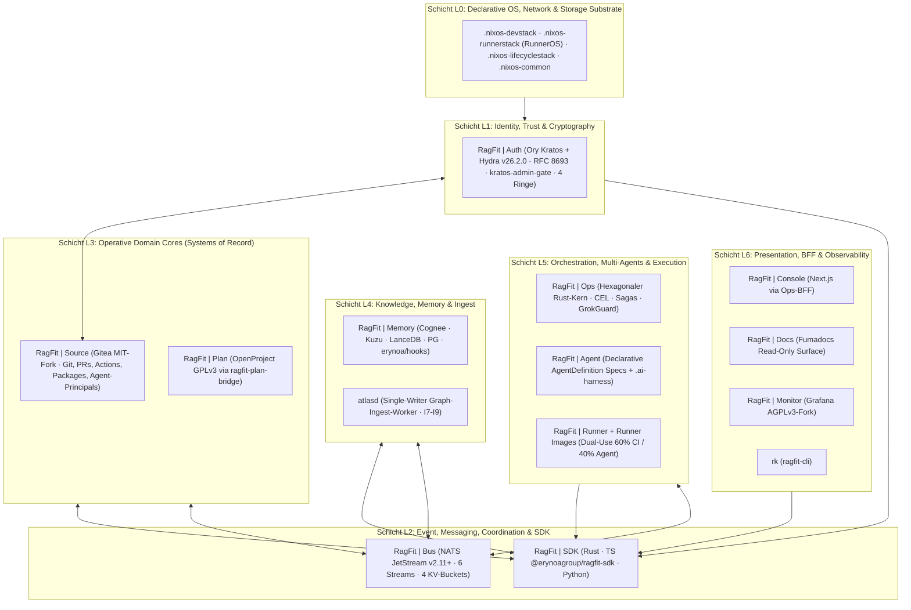
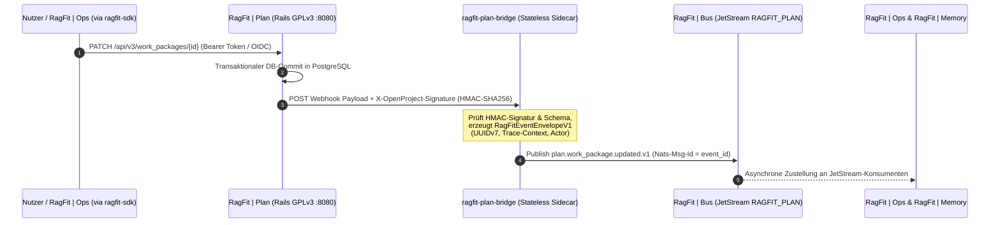

# RagFit | Plan — Systemarchitektur (RagFit v4.0 · 7-Schichten-Modell `L0`–`L6`)

> **Status:** Normativ (Architektur v4.0)  
> **Dienst:** `RagFit | Plan` (`ErynoaGroup/ragfit-plan`)  
> **Einordnung:** Plattform-Dienstfamilie `RagFit | *` · **Schicht L3 (Operative Domain Core — Project & Work Management SoR · GPLv3)**

---

## 1. Einordnung in die RagFit v4.0 7-Schichten-Gesamtarchitektur (`L0`–`L6`) & `W8`-Auflösung

Gemäß der kanonischen **`W8`-Auflösung** bezeichnet **RagFit** exklusiv die souveräne, 7-schichtige (`L0`–`L6`) **Agent-First-Plattform-Dienstfamilie (`RagFit | *`)** für Software-Engineering, Projektsteuerung, hybrides Wissensmanagement, Observability und Multi-Agenten-Orchestrierung.

Innerhalb der **7-Schichten-Gesamtarchitektur (v4.0, `L0`–`L6`)** bildet **`RagFit | Plan`** das **System of Record (SoR)** in **Schicht L3 (Operative Domain Cores)** für Projektplanung, Hierarchien (`Projects`), Arbeitspakete (`WorkPackages`), Iterationen (`Sprints`/`Versions`), Beziehungen (`Relations`), Agile Boards und Zeiterfassung (`TimeEntries`) — unter strikter **GPLv3-Lizenzisolation** über das zustandslose Sidecar `ragfit-plan-bridge`.

---

## 2. Die 7 Schichten (`L0`–`L6`) und ihre Kopplung zu `RagFit | Plan`

| Schicht | Dienste & Systemeinheiten | Kopplung mit `RagFit \| Plan` |
|---|---|---|
| **`L0` — Substrate** | `.nixos-devstack`, `.nixos-runnerstack` (`RunnerOS`), `.nixos-lifecyclestack`, `.nixos-common` | Läuft als lizenzisolierter Container-Workload auf dem NixOS-/k3s-Plattform-Cluster (`.nixos-devstack`) mit eigenem PostgreSQL-Cluster (CloudNativePG `verify-full`) und S3-kompatiblem Attachment-Speicher. |
| **`L1` — Identity & Trust** | `RagFit \| Auth` (Ory Kratos + Hydra v26.2.0, `kratos-admin-gate`, 4 kryptographische Ringe) | `RagFit \| Auth` (Ory Kratos + Hydra) liefert zusammen mit `RagFit \| Source` die OIDC-Identitäts- und Gruppen-Claims (`<org>:<team>`). `RagFit \| Plan` prüft diese Claims fail-closed beim Login (`0003-oidc-login-gate.patch`). |
| **`L2` — Event Fabric & SDK** | `RagFit \| Bus` (NATS JetStream: 6 Streams, 4 KV-Buckets) + `RagFit \| SDK` | `RagFit \| SDK` spricht `RagFit \| Plan` von außen ausschließlich über die dokumentierte HTTP REST API v3 (HAL+JSON) an. Für asynchrone Events auf `RagFit \| Bus` (`ragfit-events` / `RAGFIT_PLAN`) fungiert das externe Sidecar `ragfit-plan-bridge` als lizenzisolierter Webhook-zu-CloudEvents-Übersetzer. |
| **`L3` — Operative Domain Cores** | `RagFit \| Source` (Gitea MIT-Fork), `RagFit \| Plan` (OpenProject GPLv3 via `ragfit-plan-bridge`) | `RagFit \| Source` und **`RagFit \| Plan`** halten strikt getrennte Datenbanken. `Plan` besitzt exklusiv Projects, WorkPackages, Sprints und TimeEntries; Verknüpfungen zwischen Pull Requests in `Source` und WorkPackages in `Plan` (`[Z-2159]`) erfolgen ereignisgetrieben. |
| **`L4` — Knowledge & Memory** | `RagFit \| Memory` (Cognee + Kùzu + LanceDB + PG + `erynoa/hooks`) + Single-Writer `atlasd` ($\mathbf{I_7}$) | Der Single-Writer `atlasd` konsumiert `plan.work_package.*.v1`-Events über `ragfit-knowledge-requests` und indiziert Projekt- und Spezifikationskontexte in `RagFit \| Memory`. |
| **`L5` — Orchestration & Execution** | `RagFit \| Ops` (Rust-Kern + `GrokGuard`), `RagFit \| Agent` (`.ai-harness`), `RagFit \| Runner` (+ `Runner Images`) | `RagFit \| Ops` orchestriert `WorkOrder`- und Agenten-Workflows auf Basis von `plan.work_package.*.v1`-Events und aktualisiert den Arbeitsfortschritt synchron über `ragfit-sdk` gegen die REST API v3 von `RagFit \| Plan`. |
| **`L6` — Presentation & Observability** | `RagFit \| Console` (via Ops-BFF), `RagFit \| Docs`, `RagFit \| Monitor` (Grafana AGPLv3-Fork), `rk` CLI | `RagFit \| Console`, `RagFit \| Docs` und `RagFit \| Monitor` binden sich über die gemeinsame Erynoa-Header-Navigation (`0005-erynoa-header.patch`) nahtlos an `RagFit \| Plan` an; `Monitor` erfasst Health- und Laufzeitmetriken. |

---

## 3. Strikte GPLv3-Lizenzisolation & `ragfit-plan-bridge`

`RagFit | Plan` basiert auf OpenProject und steht unter der **GNU General Public License v3 (`GPL-3.0-only`)**. Um eine Lizenzkontamination (Copyleft-Propagation) auf proprietäre Plattformkomponenten (`ragfit-sdk`, `ragfit-ops`, `ragfit-agent`) rechtlich und technisch auszuschließen, gelten verbindliche Isolationsregeln:

1. **Kein In-Process-Linking proprietärer Bibliotheken:**
   Weder der Rust-Crate `ragfit-sdk` noch FFI-/C-Bindings oder proprietäre NATS-Envelopes werden in den Ruby-/Rails-Prozess von `RagFit | Plan` gelinkt oder als Gem eingebunden.
2. **Kommunikation ausschließlich über Standard-Netzwerkprotokolle:**
   Eingehende Aufrufe nutzen ausschließlich die standardisierte OpenProject HTTP/REST API v3 (`application/hal+json`) und OpenID Connect.
3. **Stateless Sidecar `ragfit-plan-bridge` für `RAGFIT_PLAN`:**
   Zustandsänderungen in `RagFit | Plan` werden über den nativen OpenProject-Webhook-Mechanismus (mit HMAC-SHA256-Signatur) an das **externe, zustandslose Sidecar `ragfit-plan-bridge`** gesendet. Erst dieses prozessual und containerseitig getrennte Sidecar verpackt die Nutzlast in das kanonische `RagFitEventEnvelopeV1` und publiziert sie auf den NATS JetStream Stream **`RAGFIT_PLAN`**:

### Publizierte Event-Subjects auf Stream `RAGFIT_PLAN`:
- `plan.work_package.created.v1` — Neues Arbeitspaket angelegt
- `plan.work_package.updated.v1` — Status-, Zuweisungs- oder Attributänderung eines Arbeitspakets
- `plan.sprint.started.v1` / `plan.sprint.completed.v1` — Lebenszyklus-Ereignisse einer Iteration/Version

---

## 4. OIDC-Authentifizierung & Fail-Closed Team-Autorisierung

Die Authentifizierung in `RagFit | Plan` ist durch die Patches `0001` bis `0003` gehärtet:

1. **Nur vollständige `<org>:<team>`-Claims:**
   Sowohl `RAGFIT_OIDC_<PROVIDER>_LOGIN_GROUPS` (Login-Berechtigung) als auch `RAGFIT_OIDC_<PROVIDER>_ADMIN_GROUP` (automatische Synchronisation des Admin-Flags bei jedem Login) akzeptieren ausschließlich vollständige Team-Claims der Form `<org>:<team>` (z. B. `ErynoaGroup:plan-user`, `ErynoaGroup:platform-admin`). Ein bloßer Organisationsname ohne Doppelpunkt wird mit Warnung ignoriert und öffnet niemals den Zugang.
2. **Fail-Closed & Passwort-Sperre:**
   Fehlt der `groups`-Claim oder ist `LOGIN_GROUPS` nicht valide gesetzt, wird der Login vor jeder Kontoanlage abgewiesen. Konten mit einer OIDC-Verknüpfung (`user_auth_provider_links`) sind über `Users::PasswordLogin.allowed?` bedingungslos für Passwort-Logins und Basic-Auth gesperrt.
3. **Log-Hygiene:**
   Abgewiesene OIDC-Anmeldungen protokollieren ausschließlich Provider-Slug und Login-Namen, niemals den vollständigen OmniAuth-Hash oder E-Mail-/Gruppen-Claims.

---

## 5. Leichtgewichtiger Nix-Container-Build & Lieferkette

Neben dem mehrstufigen Produktions-Dockerfile (`docker/prod/Dockerfile`, inkl. Vorabkomprimierung statischer Assets mittels `ragfit/build/precompress-assets.sh`) stellt `flake.nix` ein leichtgewichtiges, bit-reproduzierbares OCI-Image über `pkgs.dockerTools.buildLayeredImage` bereit:

- **Build-Kommando:** `nix build .#container` bzw. `just image` (Alias: `just build-image`).
- **Rootless-Design:** Läuft unter UID/GID `1000:1000`, exponiert Port `8080/tcp` und bündelt `cacert`, `tzdata`, `bashInteractive`, `curl`, `coreutils`, die Marken- und Header-Assets (`ragfit/brand/`, `public/erynoa/`) sowie alle GPLv3-Pflichtdokumente unter `/usr/share/doc/ragfit-plan/{LICENSE,COPYRIGHT,COPYRIGHT_short,CHANGES-RAGFIT.md}`.
